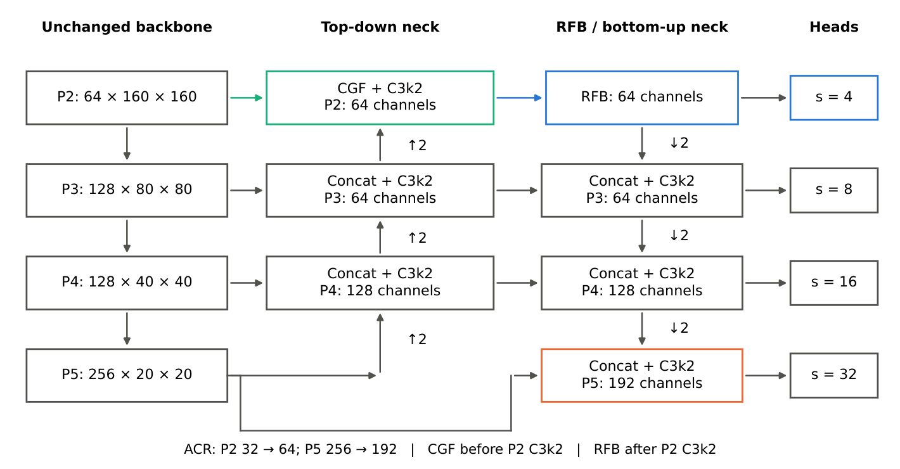
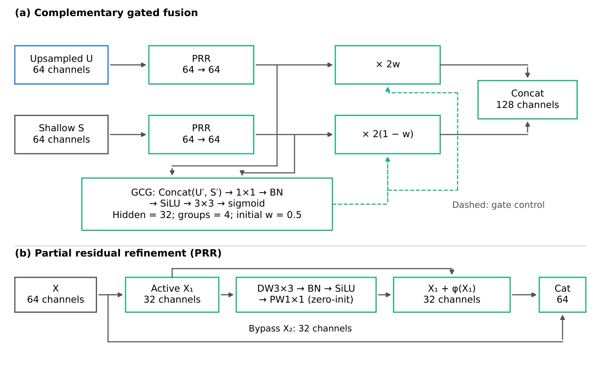
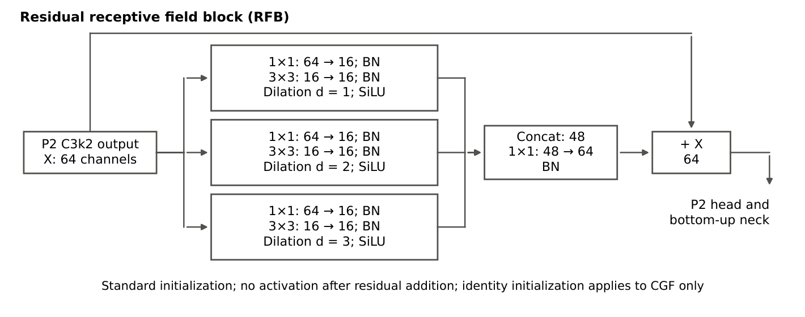
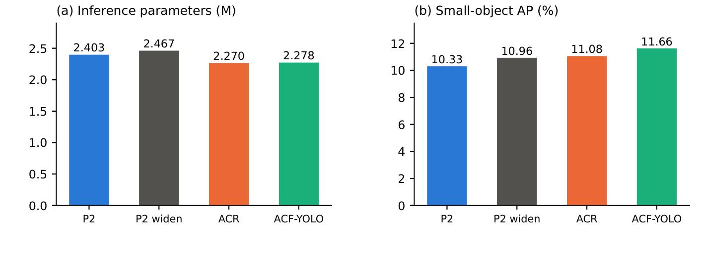
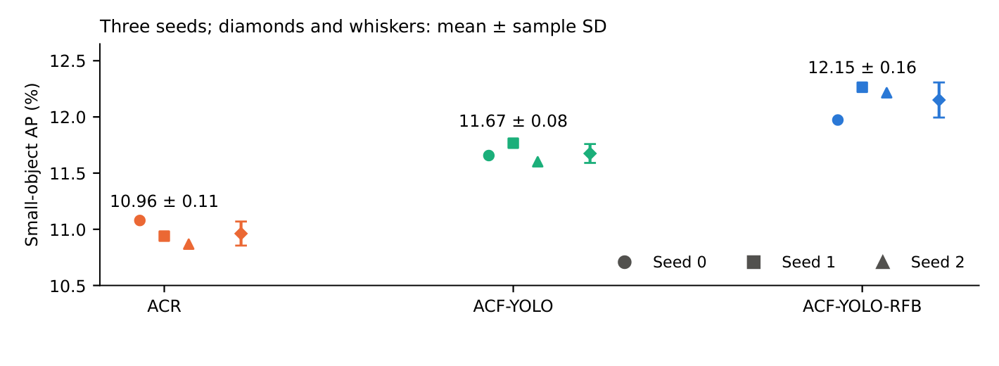
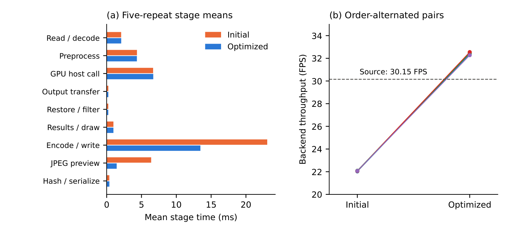
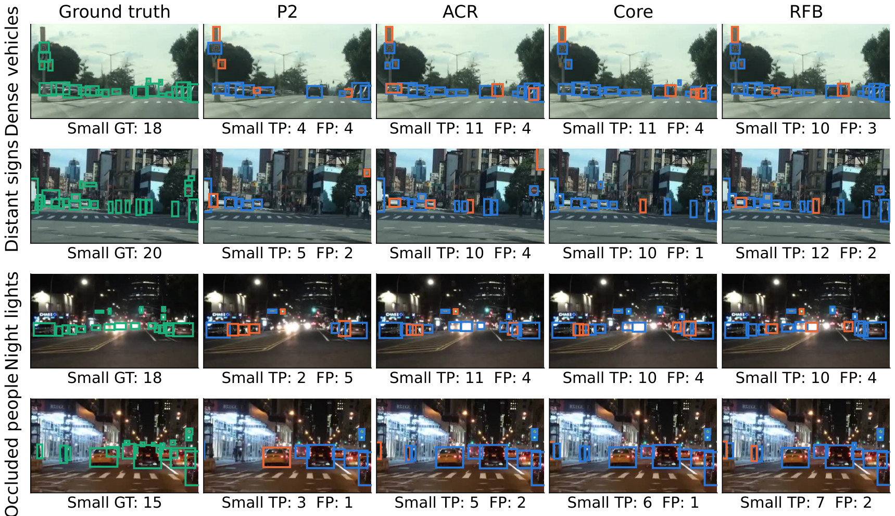

# ACF-YOLO-RFB: Capacity Reallocation and Complementary Gated Fusion for Small Road Object Detection

  

Official evidence base for the manuscript *"Capacity Reallocation and Complementary Gated Fusion with Multi-Scale Context for Small Road Object Detection"* (under review). The detector starts from a four-scale YOLO26n-P2 baseline and adds two structural modifications plus a light context block:

- **ACR** — asymmetric capacity reallocation: widen the stride-4 (P2) branch to 64 ch, narrow the deepest neck branch to 192 ch, accounting for detection-head width coupling.
- **CGF** — complementary gated fusion: partial residual refinement plus grouped spatial gates on each fused stream; zero initialization recovers the original concatenation at insertion.
- **RFB** — a residual receptive-field block with three lightweight dilated branches.

On BDD100K (matched batch-32 ablations), small-object AP improves **10.33 → 11.08 (ACR) → 11.66 (CGF) → 11.97 (RFB)**. The final model has **2.291 M inference parameters, 4.64% fewer than the P2 baseline** (GFLOPs 6.57 → 9.20), and reaches **12.15 ± 0.16 mean small-object AP over three seeds**. Frozen transfer (KITTI / VisDrone / foggy RTTS) and a Jetson AGX Orin 32 GB deployment with a browser workbench at **32.028 FPS sustained** are included, with the manuscript's limits stated explicitly.

All README numbers follow the manuscript's scope and definitions (see [Scope and definitions](#scope-and-definitions)).

## Highlights

1. Scale-aware P2/P5 reallocation improves small-object AP with fewer parameters.
2. Identity-initialized grouped fusion selects between shallow and deep streams.
3. A lightweight RFB reaches 12.15 mean small-object AP across three seeds.
4. Frozen KITTI, VisDrone, and RTTS tests expose domain-dependent gains.
5. A bounded AGX Orin backend sustains 32.028 FPS in a 30-minute video loop.

## Architecture

<p align="center">
  
</p>

<p align="center">
  
</p>

<p align="center">
  
</p>

| Component | Configuration | Code | Notes |
|---|---|---|---|
| P2 baseline | `configs/models/yolo26n-p2-widen.yaml` (control: P2 widen) | — | official P2: `32→64 ch` widen control included |
| ACR | [`configs/models/yolo26n-p2-acr.yaml`](configs/models/yolo26n-p2-acr.yaml) | pure YAML, zero custom code | P2 branch 32→64 ch, deepest neck branch 256→192 ch |
| CGF | [`configs/models/yolo26n-p2-acr-acfr.yaml`](configs/models/yolo26n-p2-acr-acfr.yaml) | [`sdf/modules/acfr.py`](sdf/modules/acfr.py) (implemented as `ACFRConcat`) | PRR + GCG, +8,132 params; ablations: `yolo26n-p2-acr-acfr-nogate.yaml` (GCG only) / `yolo26n-p2-acr-acfr-norefine.yaml` (PRR only) |
| RFB | [`configs/models/yolo26n-p2-acr-acfr-rfb.yaml`](configs/models/yolo26n-p2-acr-acfr-rfb.yaml) | [`sdf/modules/rfb.py`](sdf/modules/rfb.py) (`RFBlock`) | three dilated branches (rate 1/2/3) + residual, +13,376 params |

## Main results

**Progressive ablation on BDD100K val** (10k images, 640 input, COCO-style; percentages):

| Model | Batch | Params (M) | GFLOPs | AP | AP_s | AR_s | AP_m | AP_l |
|---|---|---|---|---|---|---|---|---|
| YOLO26n | 64 | 2.377 | 5.32 | 25.54 | 8.88 | 23.71 | 29.09 | 50.82 |
| YOLO26n-P2 (baseline) | 32 | 2.403 | 6.57 | 26.93 | 10.33 | 28.79 | 32.50 | 51.93 |
| + ACR | 32 | 2.270 | 8.10 | 28.05 | 11.08 | 30.80 | 31.86 | 52.64 |
| + CGF (**ACF-YOLO**) | 32 | 2.278 | 8.50 | 28.23 | 11.66 | 31.29 | 31.83 | 52.13 |
| + RFB (**ACF-YOLO-RFB**) | 32 | 2.291 | 9.20 | 28.38 | 11.97 | 30.96 | 32.17 | 52.21 |

> Native YOLO26n (batch 64) is a historical reference; structural comparisons use matched batch 32. Params are the batch-normalization-fused one-to-one inference graph at 640 input; percentages are computed from exact (unrounded) parameter counts. Core vs. P2 baseline: AP +1.30, AP_s +1.33, params −5.20%, FLOPs +29.38%. Final vs. matched P2 (seed 0): +1.64 AP_s (≈15.9% relative).

**Three-seed stability** (small-object AP):

| Model | Seed 0 | Seed 1 | Seed 2 | Mean ± sample SD |
|---|---|---|---|---|
| + ACR | 11.08 | — | — | 10.96 ± 0.11 |
| + CGF (ACF-YOLO) | 11.66 | — | — | 11.67 ± 0.08 |
| + RFB (ACF-YOLO-RFB) | 11.97 | 12.26 | 12.22 | **12.15 ± 0.16** |

> SDs are over three training seeds (n = 3) and are **not** confidence intervals. Pooled image-bootstrap interval for RFB vs. core over three fixed seed pairs: [0.32, 0.67] pp.

<details>
<summary><strong>Detector references at seed 0</strong> (batch sizes reported, not matched)</summary>

| Model | Batch | AP | AP_s |
|---|---|---|---|
| YOLOv8n | 32 | 25.55 | 8.35 |
| YOLOv10n | 32 | 26.25 | 8.92 |
| YOLO11n | 64 | 25.20 | 8.15 |
| YOLO26n | 64 | 25.54 | 8.88 |
| YOLO26n-P2 | 64 | 26.82 | 10.15 |
| ACF-YOLO | 32 | 28.23 | 11.66 |
| ACF-YOLO-RFB | 32 | 28.38 | 11.97 |
| YOLO26s-P2 | 16 | 31.37 | 13.14 |

</details>

<p align="center">
  
  
</p>

## Frozen cross-dataset transfer

No fine-tuning, no threshold adjustment, no model reselection. Each cell: AP / AP_s / AP_m / AP_l (%), mapped-class COCO-style AP under frozen conversion protocols.

| Model | KITTI (7,481) | VisDrone val (548) | RTTS fog (4,322) |
|---|---|---|---|
| P2 | 24.59 / 13.51 / 24.85 / 34.11 | 4.33 / 2.65 / 6.69 / 18.08 | 24.14 / 12.24 / 28.65 / 34.41 |
| ACR | 24.48 / **12.73** / 25.13 / 33.45 | 4.48 / 3.07 / 7.19 / 16.57 | 25.02 / 12.93 / 29.60 / 35.10 |
| Core (ACF-YOLO) | 24.55 / 14.40 / 25.17 / 33.53 | 4.48 / 2.87 / 6.82 / 15.86 | 24.97 / 13.25 / 29.48 / 34.52 |
| RFB (ACF-YOLO-RFB) | 24.60 / 14.37 / 25.36 / 33.55 | **4.76** / 3.04 / 7.25 / 15.19 | **25.52 / 13.71** / 30.24 / 35.64 |

Gains are domain-dependent: on KITTI, ACR **decreases** AP_s from 13.51 to 12.73 (CGF restores it to 14.40); on VisDrone all models are weak under the aerial viewpoint shift. Transfer results are descriptive: no external significance tests, no repeated-seed transfer analysis, and absolute AP must not be used to rank domain difficulty (KITTI Cyclist→bike is an approximate task mapping).

Evidence: [`results/kitti-zeroshot/`](results/kitti-zeroshot/), [`results/visdrone-zeroshot/`](results/visdrone-zeroshot/), [`results/rtts-zeroshot/`](results/rtts-zeroshot/).

## Edge deployment (Jetson AGX Orin 32 GB)

Environment: MAXN_SUPER with fixed clocks, JetPack 7.2.1 / L4T R39.2, CUDA 13.2, TensorRT 10.16.2. ONNX opset 13, static 1×3×640×640, end-to-end head (no NMS, no custom plugins); the deployed RFB FP16 engine (FP32 input/output, half-precision weights) occupies ≈ 8.8 MB.

| Measurement | Core (ACF-YOLO) | RFB (ACF-YOLO-RFB) |
|---|---|---|
| H2D transfer + engine, median (ms) | 4.82 | 5.12 |
| trtexec GPU compute (ms) | 4.54 | 4.79 |
| Image pipeline (ms / FPS) | 16.30 / 61.34 | 16.65 / 60.07 |
| Stitched video (FPS) | 34.37 | 33.87 |
| Continuous driving video (FPS) | 39.04 | 38.56 |

- **Consistency**: on a fixed 1,000-image subset, Jetson and RTX 3090 TensorRT FP16 differ by at most 0.01 AP point (core and RFB); RFB FP16/FP32 matched boxes have mean IoU 0.986.
- **Backend**: an optimized Python-standard-library backend processes **57,651 frames in a 30-minute looped-video run at 32.028 FPS**, including decoding, recording, preview generation and logging. It loops one fixed clip — this is not a hard-real-time guarantee (P95 frame latency 36.4 ms exceeds the ~33.2 ms frame period) and not camera-to-display performance.
- **Limits**: at the operating confidence of 0.25 the final model still misses more than half of small objects on Jetson (Recall_s 46.87%; medium 76.01%, large 93.43%), and 69.95% of RFB small-object segments last at most two frames. These four statistics are computed from per-image predictions that stay outside the repository (see the traceability note below).

Evidence: [`results/jetson-deploy/`](results/jetson-deploy/), workbench in [`yolo-system/`](yolo-system/) (acceptance: `yolo-system/ACCEPTANCE.json`).

<p align="center">
  
</p>

## Qualitative results

<p align="center">
  
</p>

Selected BDD100K crops at confidence 0.25 (columns: ground truth, P2, ACR, core, RFB; green = ground truth, blue = correct, orange = false positive). The examples illustrate changes and remaining errors — including added false positives — rather than average accuracy.

## Reproducibility

```bash
conda activate yolo26-sdf
python -m pip install --no-build-isolation --no-deps -e .
PYTHONPATH=upstream:. python scripts/verify_setup.py
PYTHONPATH=upstream:. python -m unittest discover -s tests -v

# Build any model from YAML (ACR / CGF / RFB / teacher all construct cleanly)
PYTHONPATH=upstream:. python - <<'PY'
from ultralytics import YOLO
YOLO("configs/models/yolo26n-p2-acr-acfr-rfb.yaml").info()   # final model
YOLO("weights/ACF-YOLO-RFB.pt").info()   # trained checkpoint (batch32, seed 0, 200 epochs)
PY

# Formal training only via the launcher (guards configs/data/checkpoints/outputs)
PYTHONPATH=upstream:. python scripts/run_experiment.py --help
```

`upstream/` is a frozen Ultralytics 8.4.104 snapshot (AGPL-3.0) — all experiments run with `PYTHONPATH=upstream:.` for version pinning. Note that `m.info()` reports the training-graph parameter count (including the train-only one-to-many head); the tables above use the BN-fused one-to-one inference graph (2.291 M). Datasets: BDD100K 10k detection split (train 70k / val 10k), KITTI, VisDrone, RTTS via the frozen conversion protocols in `docs/protocols/`.

## Repository map

| Manuscript component | Code / config | Evidence |
|---|---|---|
| ACR + widen control | `configs/models/yolo26n-p2-acr.yaml`, `yolo26n-p2-widen.yaml` | `results/acr-stage20/` |
| CGF (+ component ablation) | `sdf/modules/acfr.py`, `…-acfr{-nogate,-norefine}.yaml` | `results/acfr-stage20/` |
| RFB + three seeds | `sdf/modules/rfb.py`, `…-acfr-rfb.yaml` | `results/p29-context-screen/` |
| Frozen transfer | — | `results/{kitti,visdrone,rtts}-zeroshot/` |
| Server timing / TensorRT | `scripts/benchmark_*.py` | `results/acr-stage20/`, `results/acfr-stage20/` |
| Jetson + workbench | `yolo-system/` | `results/jetson-deploy/`, `yolo-system/experiments/` |
| Paired bootstraps | `scripts/bootstrap_bdd_paired_ap.py` | `results/*/bootstrap-*.json` |
| Claim audits / tests | `scripts/audit_paper_claims.py`, `tests/` | CI-runnable |

Large raw artifacts (per-image predictions `*.predictions.jsonl.gz`, non-final weights, TensorRT engines, datasets) are **not** committed. Every table and headline number above is backed by a committed JSON with its frozen metadata; the four per-image limit statistics in the deployment section (Recall_s by scale, segment continuity) are reproduced from per-image predictions retained in the internal audit tree.

## Scope and definitions

- **Parameter definitions.** Params in this README are the batch-normalization-fused, one-to-one **inference graph** at 640 input (final model 2.291 M; P2 baseline 2.403 M). The companion document [`docs/paper/THESIS_RESULTS.md`](docs/paper/THESIS_RESULTS.md) uses the Chinese thesis convention (**training graph** incl. the one-to-many head, YOLO26n baseline); those numbers are internally consistent there but must not be mixed into the comparisons above.
- **Batch and selection.** YOLO26n rows are historical references (batch 64); structural ablations are matched batch 32; distillation comparisons are batch 16. Checkpoints are selected on validation, so all results are validation results, not held-out test results.
- **Timing scopes.** H2D+engine latency (CUDA events, 520 timed forwards after 48 warm-ups), image pipeline, offline video, and the backend loop are different scopes — do not compare across scopes.
- 中文口径说明：[`docs/paper/THESIS_RESULTS.md`](docs/paper/THESIS_RESULTS.md) 是中文硕士学位论文（v2）的数字与证据对照索引，参数量与基线定义与本 README 不同，数字不可互相代入。

## Beyond the manuscript's main line

The evidence tree also contains branches that the manuscript deliberately keeps out of its structural main line. Matched batch-16 output distillation from a YOLO26s-P2 teacher raises overall AP to 28.70 (core: 28.23) but leaves small-object AP essentially unchanged (11.67 vs. 11.66 against the batch-32 core; paired image bootstrap P(Δ>0) = 0.54), and RFB + distillation reaches overall AP 29.01 without retaining the small-object gain (AP_s 11.66). The small-object-focused configuration therefore remains **RFB without distillation**. Structural-lightweighting variants, resolution routing and other closed routes stay in `results/` with their metric evidence for review. Evidence: [`results/kd-arms/`](results/kd-arms/), [`results/kd-teacher/`](results/kd-teacher/), [`results/p31-kd-rfb/`](results/p31-kd-rfb/).

## Citation & License

Citation information will be added upon publication. This repository is released under **AGPL-3.0** (see [`LICENSE`](LICENSE)); `upstream/` is a modified Ultralytics 8.4.104 snapshot under its original AGPL-3.0 license and copyright; third-party files under `yolo-system/vendor/` follow their own notices. Manuscript figures are copyright of the authors.
