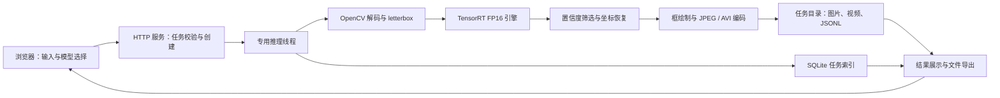

# 第六章系统实现增补稿（待整合）

> 独立增补材料，未修改 `ch06_v2_20261017/CHAPTER.md`。建议在硬件与推理流程之后增加“道路小目标检测工作台设计与实现”，统一调整本章节号和图表号。

## 道路小目标检测工作台设计与实现

为使模型部署结果能够用于交互验证与应用演示，本文在 Jetson AGX Orin 平台上构建道路小目标检测工作台。系统采用浏览器与后端分离职责的结构：浏览器负责输入选择、参数配置、检测画面与结果展示，Jetson 后端负责媒体解码、TensorRT 推理、检测框绘制及任务留档。前端静态资源与 API 由同一服务提供，用户通过局域网访问，无需在客户端安装推理环境。

系统默认采用 ACF-YOLO-RFB，并保留 ACF-YOLO 与 ACF-YOLO-KD 作为对照。三种模型均使用板端构建的 TensorRT FP16 引擎，输入尺寸为 640×640，批大小为 1。系统复用部署实验中的预处理、推理与坐标恢复代码，使应用侧和实验侧遵循相同的输入缩放与输出解释规则。模型采用端到端检测头，后处理主要由置信度筛选和坐标恢复构成，不额外执行 NMS。

### 系统组成与数据流

系统由浏览器交互界面、HTTP 服务、推理工作线程和任务存储四部分组成。浏览器提交图片或视频后，服务创建唯一任务标识，记录模型、工作阈值和输入来源，并将任务交给专用推理线程。工作线程在同一线程中创建和使用 CUDA 上下文，顺序执行预处理、推理、输出回传和绘制。状态查询由独立 HTTP 请求处理线程提供，避免长视频处理阻塞网页状态刷新。

为限制资源竞争，当前实现同时只运行一个推理任务；已有任务运行时，新任务收到忙碌提示。视频任务支持人工停止，已处理帧的标注视频与逐帧记录仍会保存。服务启动时检查历史任务，将上一次未完成的任务标记为中断，避免将其误显示为成功完成。

### 主要功能

| 功能 | 实现内容 | 验收状态 |
|---|---|---|
| 图片检测 | 上传图片并展示类别、置信度、原图边界框和小目标标记 | 已通过 |
| 模型对比 | 同一图片、同一阈值下依次执行三种模型并排展示 | 已通过 |
| 视频检测 | 上传视频或使用行车素材，刷新标注帧并生成标注视频 | 已通过短视频上传与行车素材运行检查 |
| 工作参数 | 选择模型及置信度阈值，不修改训练或冻结评测设置 | 已通过 |
| 停止与互斥 | 停止当前视频并保存结果；并发启动请求返回忙碌提示 | 已通过 |
| 历史与导出 | SQLite 保存索引，导出 JSON、JSONL、CSV、标注图片和 AVI | 已通过 |
| 设备监测 | 读取热区温度、内存、磁盘剩余与系统负载 | 已通过 |
| 摄像头 | 读取板端 `/dev/video0` | 接口已实现，设备未连接，未完成真机验收 |

界面对原图预测框面积小于 32×32 像素的检测结果进行黄色高亮，帮助观察远处目标的检出情况。该统计来自预测框，不含真实标注匹配，因此仅作为交互展示，不能替代小目标 AP 或召回率。视频累计框数表示逐帧检出框数之和，同一物体可在多帧中重复计数，不能解释为独立车辆数量。

### 数据留档与可追溯性

系统为每个任务建立独立目录，保存结果 JSON，以及标注图片或标注视频和逐帧 JSONL。任务记录包括输入文件名、输入文件 SHA-256、引擎 SHA-256、模型标识、阈值、输入尺寸、精度、创建时间和终止状态。用户可导出任务汇总 CSV，用于整理展示实验与复核运行条件。三模型对比在 JSON 中分别保存各模型结果，避免把不同模型的检测框混为一组。

### 系统功能测试与性能口径

系统部署后使用真实引擎和道路素材执行自动集成测试，检查设备与模型可用性、非法阈值拒绝、跨源请求拒绝、结果路径访问限制、三模型图片推理、图片上传、无效图片失败记录、12 帧视频上传及编码、任务冲突、停止保存与 CSV 导出，11 类检查全部通过。验收详情见工作台源码目录中的 `ACCEPTANCE.json`，对应结果通过任务 ID 可追溯。

系统界面中的 GPU 延迟采用 CUDA 事件计时，包含输入由主机传至设备的时间。视频处理 FPS 由服务器处理帧数和处理时间计算，包含读帧、预处理、推理、输出回传、绘制及编码等开销，但不包含局域网传输与浏览器显示。该口径与本章前述冻结基准测试有所区别，不将交互工作台的单次显示值替换为正式基准结果，也不据此推断浏览器端实时帧率。

在一次完整行车视频功能运行中，系统处理了 452 帧，包含标注视频保存、JPEG 预览和逐帧 JSONL 留档的吞吐为 22.00 FPS，P50/P95 帧耗时分别为 44.585/45.855 ms，GPU 平均推理时间为 5.506 ms。这一结果说明当前交互与留档开销需要进一步优化；本次运行不采用正式基准的多轮重复协议，只作为功能验收及单次运行观察，不能宣称网页系统已达到 30 FPS。

系统由用户级 systemd 服务管理，配置为开机启动与异常退出自动重启，并启用用户服务驻留。当前完成了服务运行与局域网访问检查；摄像头真机测试、整机重启后的服务复验和长期连续运行测试仍属于后续验证内容。

### 界面图与证据

可使用本目录的 `workbench.png` 作为实际运行界面素材。图题建议为“道路小目标检测工作台运行界面”。最终论文排版时应另取宽屏全界面截图，确保模型选择、检测画面和性能指标可辨识；当前截图为窄屏自适应界面。

增补本节后，章首研究内容、本章小结和总论文结论应同步补充“实现浏览器交互、板端推理和结果追溯”的工程成果，避免把系统界面开发表述为新的检测算法贡献。
